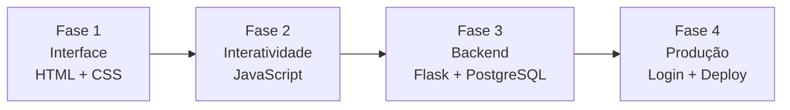

<p align="center">
  
</p>

<h1 align="center">🗂️ Meu Kanban Pessoal</h1>

<p align="center">
  Um sistema pessoal para organizar tarefas, projetos, aulas e cursos, construído passo a passo para aprender desenvolvimento web e backend.
</p>

<p align="center">
  
  
  
</p>

---

## 🗺️ Sumário

- [Sobre o projeto](#-sobre-o-projeto)
- [Progresso do desenvolvimento](#-progresso-do-desenvolvimento)
- [Roadmap](#️-roadmap)
- [Tecnologias](#️-tecnologias)
- [Funcionalidades planejadas](#-funcionalidades-planejadas)
- [Como abrir a versão atual](#️-como-abrir-a-versão-atual)
- [Estrutura do projeto](#-estrutura-do-projeto)
- [Aprendizados](#-aprendizados)
- [Autor](#-autor)

---

## 📌 Sobre o projeto

O **Meu Kanban Pessoal** é um projeto full stack em construção. O objetivo é aprender os fundamentos do desenvolvimento enquanto crio uma aplicação real, **da interface ao banco de dados e à publicação online**.

A primeira versão vai organizar as tarefas em três colunas:

| 📥 Não iniciados | 🚧 Em andamento | ✅ Concluído |
|:---:|:---:|:---:|
| O que ainda vai começar | O que está sendo feito agora | O que já foi entregue |

> [!NOTE]
> Este é um projeto de aprendizado: o código evolui a cada etapa, e o README acompanha essa evolução.

---

## 📊 Progresso do desenvolvimento

**4 de 10 etapas concluídas (40%)**

- [x] Criar a estrutura inicial em HTML
- [x] Criar colunas e cartões estáticos
- [x] Criar formulário visual de nova tarefa
- [x] Estilizar o Kanban com CSS
- [ ] Criar tarefas dinamicamente com JavaScript
- [ ] Salvar tarefas no navegador
- [ ] Criar API com Python e Flask
- [ ] Conectar o sistema ao PostgreSQL
- [ ] Adicionar cadastro e login de usuários
- [ ] Publicar o sistema online

---

## 🛣️ Roadmap

O projeto está dividido em quatro fases:



| Fase | Foco | Etapas | Situação |
|:---:|---|---|:---:|
| 1 | Interface | Estrutura em HTML, colunas e cartões, formulário, estilo com CSS | ✅ Concluída |
| 2 | Interatividade | Criar tarefas com JavaScript, salvar no navegador | ⚪ Planejada |
| 3 | Backend | API com Python e Flask, conexão com PostgreSQL | ⚪ Planejada |
| 4 | Produção | Cadastro e login de usuários, publicação online | ⚪ Planejada |

---

## 🛠️ Tecnologias

### ✅ Usada atualmente


### 🔜 Planejadas para as próximas etapas

| Tecnologia | Para que vai servir |
|---|---|
|  | Visual do quadro e responsividade |
|  | Criar e mover tarefas, salvar no navegador |
|  | Linguagem do backend |
|  | API que conecta o site ao banco de dados |
|  | Guardar tarefas e usuários |
|   | Controle de versões e hospedagem do código |

---

## 🎯 Funcionalidades planejadas

- [ ] Criar, editar e excluir tarefas
- [ ] Definir prioridade e prazo
- [ ] Mover tarefas entre colunas
- [ ] Filtrar tarefas
- [ ] Criar conta e fazer login
- [ ] Manter os quadros de cada usuário privados
- [ ] Acessar o sistema pela internet

---

## ▶️ Como abrir a versão atual

1. Baixe ou clone este repositório:

   ```bash
   git clone https://github.com/SEU_USUARIO/meu-kanban-pessoal.git
   cd meu-kanban-pessoal
   ```

2. Abra o arquivo `index.html` no navegador (dê dois cliques nele ou arraste para a janela do navegador).

> [!NOTE]
> A versão atual apresenta apenas a **estrutura visual inicial** do Kanban. Ainda não há estilo completo nem funcionamento: as tarefas são estáticas.

---

## 📁 Estrutura do projeto

Hoje o projeto tem só o `index.html`. Esta é a organização prevista conforme ele crescer:

```text
meu-kanban-pessoal/
├── README.md
├── index.html
├── assets/
│   └── banner-kanban.svg
├── css/          # (planejado) estilos do quadro
├── js/           # (planejado) lógica das tarefas
└── backend/      # (planejado) API em Flask
```

---

## 📚 Aprendizados

Este projeto está sendo desenvolvido para praticar:

| Área | O que vou praticar |
|---|---|
| 🌐 Front-end | HTML semântico, CSS e responsividade, JavaScript e manipulação da página |
| ⚙️ Backend | Python, APIs com Flask |
| 🗄️ Dados | Banco de dados relacional com PostgreSQL |
| 🧰 Ferramentas | Git e GitHub |

---

## 👨‍💻 Autor

Desenvolvido por **Gabriel Sá** como projeto de aprendizado e portfólio.